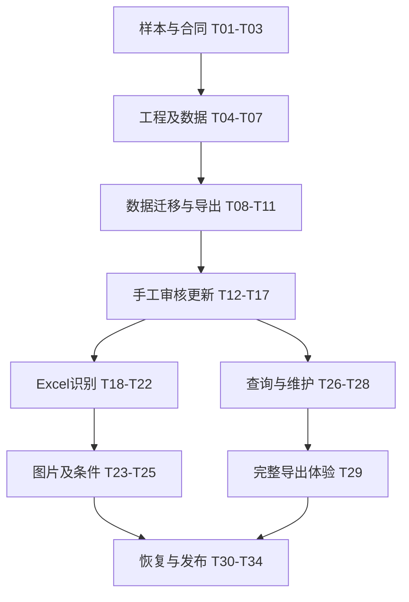

# 海运报价整理工具 V1 编码任务计划

> 公开版：金额示例已经脱敏，仅用于开发说明；真实费率和精确校验值保存在本地私有资料中。

计划日期：2026-10-17（Asia/Shanghai）  
依据：`海运报价整理工具-开发文档.md`，V1.1实施基线，最后修订2026-10-17。  
状态：T01—T05已完成；T06—T34待实施，未完成任务不代表已经开发完成。

## 1. 执行策略

采用“先做可确定的数据闭环，再接自动识别”的顺序：

**样本与合同 → 工程与数据模型 → 当前数据迁移及导出 → 手工审核与更新闭环 → Excel识别 → 图片识别 → 查询完善 → 发布验收。**

前端页面和后端领域服务同步交付，每个里程碑都应有能操作的结果。模型调用尚未配置，不阻塞手工录入、审核、应用、查询及导出。模拟模型只用于开发测试，界面明确标记，不得伪装真实识别成功。

沿用开发文档的实施默认：React + TypeScript + Vite、Python + FastAPI、SQLAlchemy + Alembic、SQLite本机盘WAL、独立Worker、工作簿读写库、可替换模型适配器。具体依赖版本在工程初始化时核实并锁定，本计划不另行指定。

第一版包含全部P0要求；聊天文字粘贴与用户自行改表后的再次导入属于P1；PDF、旧xls、AI方案比较、自动费用合计、对客利润、实时船期及订舱不进入本轮编码。

### 1.1 当前项目状态

- 已有：详细开发文档、六区域Excel、一份模板与三份真实报价样本、T01—T03资产、T04可运行前后端工程及T05数据层。
- 系统接口与目录预览可运行，31表数据库结构和迁移已完成；正式报价数据迁移、识别器及报价业务接口尚待后续任务。不能将`outputs/`中的表格脚本视为生产更新服务。
- 临时脚本可以参考规则和源位置，但不能直接复用为生产更新服务；其中硬编码港名、一次性XML修复、未确认费用解释均需要重构。
- 不改写用户原报价文件，不在开发过程中覆盖最新正式报价表。

### 1.2 全程不可破坏的规则

1. 正式导出固定六个区域sheet、18列，不附带导入、待匹配、日照或来源字典sheet。
2. 数据库是正式数据源；Excel负责读取和导出，不通过坐标覆盖数据库。
3. 目的地唯一归属一个航线；同一目的地可有多个报价，不按港名删掉不同方案。
4. 船司、币种、来源编码等缺失保留null；主运价币种不能从附加费USD推导。
5. 两价只有在确认是20GP/40尺时，才将40GP与40HQ设为同值，并记录规则。
6. 审核、匹配、应用是不同状态；模型不能直接改正式报价。
7. 完整日期参与业务判断，Excel显示`mm-dd`；实际下载文件须在目标办公软件核验。
8. 本批预览默认只看变更；旧值、新值和字段级颜色必须真实反映计划。
9. 非青岛、未匹配和排除项保留在系统内，既不丢弃，也不自动写入正式报价。
10. 新资料没有列出某个旧港口，不代表其旧报价应删除、停用或清空。

## 2. 里程碑与交付顺序

| 里程碑 | 完成后能看到什么 | 编码任务 | 必须通过的关口 |
|---|---|---|---|
| K0 样本与合同 | 可追踪的样本、字段合同、标准答案和模板配置 | T01—T03 | 基线数量可解释；模糊项不伪造确认 |
| K1 工程与数据层 | 本机网页可打开，API/Worker可启动，字典可读取 | T04—T07 | 迁移可重复；金额/日期/状态基本规则有测试 |
| K2 现有表维护与导出 | 能查看迁移后的报价，导出结构正确的六区域表 | T08—T11 | 84条历史有价记录逐项对账，Excel月日显示正确 |
| K3 手工报价完整闭环 | 手工候选可审核、预览、确认入库，导出体现更新 | T12—T17 | 幂等、冲突、空值、事务及过时预览通过 |
| K4 长荣Excel自动整理 | 上传真实xlsx，识别代码表、多港同价及重复冲突 | T18—T22 | 51条青岛展开记录有完整数量守恒和来源 |
| K5 图片自动整理 | 上传地中海图片，对照原图审核价格和条件 | T23—T25 | 39条有效报价、1条划线排除；费用例外不遗漏 |
| K6 查询与日常维护 | 能按目的地、柜型、船司和日期查价并维护字典 | T26—T29 | 不同币种不混排；码头与未知日期口径正确 |
| K7 试运行交付 | 可安装、重启、备份、恢复并通过全流程验收 | T30—T34 | 开发文档50条用例通过，阻断缺陷清零 |

K2导出是早期验证，不表示跳过K3的审核应用。当前正式数据的一次性初始化属于受控迁移；日常新报价必须走候选与变更流程。

## 3. 逐项编码任务

### K0：样本、合同与模板资产

| ID | 编码/整理内容 | 主要产物位置 | 依赖 | 完成条件 |
|---|---|---|---|---|
| T01 | 固化输入样本和人工金标准；记录hash、原位置、排除项、映射依据 | `tests/fixtures/private/`、`tests/fixtures/synthetic/` | 无 | 长荣和图片原件可定位；不依赖桌面或剪贴板临时路径；敏感原件不进入公共Git |
| T02 | 固化18列、状态枚举、金额、日期、证据和提取Schema；确定API错误结构 | `config/`、`backend/app/domain/`、OpenAPI合同 | T01 | 两价、null、PATCH省略/清空、审核版本与码头身份均有明确例子；前后端不使用两套同义枚举 |
| T03 | 从六区域表提取目录和样式配置，分开空价模板与报价迁移候选 | `config/template-qingdao-v1.json`、种子JSON、迁移说明 | T01、T02 | 六sheet、列序、绿色合并、国家空行、日期格式有配置；v8的295与v12后续新增差异可解释 |

注意：T01的标准答案要直接核对原资料，不能把历史脚本对模糊“SSH/5SH”的识别当作确定术语。

### K1：工程骨架与数据库

| ID | 编码内容 | 主要产物位置 | 依赖 | 完成条件 |
|---|---|---|---|---|
| T04 | 建立前后端工程、配置加载、同源开发连接、环境样例、启动脚本 | `backend/`、`frontend/`、`.env.example`、README | T02 | 新环境按说明启动；健康检查成功；无真实密钥；依赖锁定；模型未配时仍能访问报价页面 |
| T05（已完成） | 建立SQLAlchemy实体、外键、索引及Alembic迁移；含候选、报价修订、数据集版本和快照 | `backend/app/repositories/`、`backend/migrations/`、`docs/T05-数据层与数据库迁移完成报告.md` | T04 | 31表、两步迁移及39项数据库测试通过；已知旧修订升级备份并保留数据；同港多报价、目的地唯一航线、金额缩放整数 |
| T06 | 领域值对象与校验：Decimal、完整日期、柜型、状态迁移、字段出处、缺失问题 | `backend/app/domain/`、单元测试 | T05 | 跨年、0与null、结束早于开始、柜型缺价和审批后改值重审等测试通过 |
| T07 | 文件存储接口、任务表及独立Worker，任务认领、租约、重试、恢复和取消 | `backend/app/storage/`、`workers/`、`GET /jobs/{id}` | T05 | 重启不假成功；重复任务不会重复正式写入；临时文件不会覆盖旧原件和导出 |

K1先把访问边界放好：本机绑定127.0.0.1，同源、Host/Origin和写请求保护有效。不在此阶段建设企业多角色审批。

### K2：现有数据、报价总表与第一版导出

| ID | 编码内容 | 主要产物位置 | 依赖 | 完成条件 |
|---|---|---|---|---|
| T08 | 一次性目录及报价迁移命令；生成预演报告，确认后应用，记录来源和可恢复检查点 | `backend/app/services/bootstrap/`、迁移命令 | T03、T05、T06 | 重跑不重复增加记录；84条已有报价逐项对账；Alexandria父港/终端、纳闽双价和新目的地有解释 |
| T09 | 基础资料读取、目的地检索和报价总表分页API；报价详情/历史查询 | `api/v1/dictionaries`、`destinations`、`quotations` | T08 | 默认只青岛；无价港口返回“暂无报价”；能分别查看两码头和同港多价 |
| T10 | 建立六入口导航和报价总表页面，区域切换、筛选、详情和原文入口 | `frontend/src/pages/`、`features/quotations/` | T04、T09 | 使用真实API与持久数据；网页每行国家完整；空白不显示0；不使用合并单元格阻碍筛选 |
| T11 | 实现快照驱动六sheet导出、文件验证、下载API及导出预览基础组件 | `backend/app/exporters/`、`POST /exports`、导出页面 | T03、T07、T08 | 18列、国名首行、分隔空行、绿色分组、数值价格和mm-dd均正确；无辅助sheet；Excel/WPS验证有记录 |

T11应尽早验证真实文件。不能等网页全部做完，才发现日期显示、合并或跨区域样式损坏。

### K3：先通过手工候选走通审核与更新

| ID | 编码内容 | 主要产物位置 | 依赖 | 完成条件 |
|---|---|---|---|---|
| T12 | 候选创建/编辑、手工报价入口、草稿持久化和版本校验 | `services/candidates`、候选API、手工编辑页 | T06、T09、T10 | 编辑候选不改正式库；关闭重开可继续；省略字段不清空旧值；明确清空进入差异 |
| T13 | 标准目的地及来源命名空间匹配；相似候选只提示；受控新增/别名确认 | `services/matching`、目的地选择组件 | T12 | 多义代码或码头不明不自动应用；同港跨航线重复被阻止；新目的地可加入现有国家组 |
| T14 | 审核服务及工作台：字段证据、单条/批量审核、驳回、需补充、修改后重审 | `services/review`、`frontend/.../review/` | T12、T13 | 通过金额不消除币种/船司缺失；目的地未定可批准金额但不能正式应用；有逐项操作反馈 |
| T15 | 构建内容指纹、重复/冲突检测、报价匹配和固定变更计划 | `services/change_plan`、计划API | T13、T14 | 同价重复保留全部证据；新有效期新增报价；原期间更正新增修订；纳闽可明确并存 |
| T16 | 变更预览页面：默认只变化、旧新值、字段颜色、处理策略和选择范围 | `frontend/src/features/changes/` | T15 | 新增绿、修改黄、冲突红并有文字；未变字段不误标；本次排除/暂缓数量可解释 |
| T17 | 正式应用服务：事务、幂等、版本冲突、审计、快照、停用及反向纠正计划 | `services/application`、应用API、审计详情 | T15、T16、T05 | 同一请求应用一次；过时计划返回409；异常整体回滚；旧价格/字典历史可查；导出锁定版本 |

K3演示必须完成：手工新增香港报价 → 审核 → 应用 → 总表可见 → 下载更新后六区域表 → 仅修改20GP → 预览该格黄色 → 应用后历史仍可查看。该演示不依赖真实模型。

### K4：上传与长荣Excel识别

| ID | 编码内容 | 主要产物位置 | 依赖 | 完成条件 |
|---|---|---|---|---|
| T18 | 批次、资料组、文件上传、hash查重、大小/类型校验、受控原件读取 | `api/v1/import-batches`、上传/批次页面 | T07、T10、T12 | 单文件失败不丢其他文件；文件名不能决定存储路径；不执行宏和外链；进度真实 |
| T19 | 通用xlsx结构提取：单元格、合并、类型、日期格式、公式缓存、脚注及代码表 | `backend/app/parsers/xlsx.py`、原始网格Schema | T18、T02 | 长荣价格表与字典表区分；46物理价格行正确；无缓存公式明确报问题 |
| T20 | 标准化器：柜型、日期上下文、一格多代码、来源内映射、条件范围和来源证据 | `services/normalization`、质量规则 | T19、T06、T13 | 51青岛候选与6日照记录分开；无币种留空；确认两价后补40HQ；不把代码外形当标准码 |
| T21 | 将识别输出接入审核台；Excel原文定位、失败重试、重跑与人工稿比较 | 上传页、批次详情、审核原文区 | T20、T14、T16、T17 | 多次识别不覆盖人工稿；51→48→45+3转化有明细；导入后仅六sheet |
| T22 | 长荣样本集成回放与异常用例修正 | 集成/E2E测试、人工核对报告 | T21、T11 | 45历史可应用、3待匹配、3重复合并及纳闽两价全部解释；哥打基纳巴卢按私有源单元格金额保留，不自动改值 |

T20可以先通过程序规则和人工配置完成长荣样本；复杂布局语义适配与T23共用模型接口，不把长荣这一份文件的行号和港口清单硬编码成通用解析器。

### K5：图片识别与费用条件

| ID | 编码内容 | 主要产物位置 | 依赖 | 完成条件 |
|---|---|---|---|---|
| T23 | Provider适配器、提取Schema校验、提示词版本、超时/重试、使用量与受控原响应 | `model_adapters/`、`config/extraction-schema-v1.json` | T02、T07、T18 | 不同provider统一返回候选；无密钥不伪造成功；模型输出不得直写正式库 |
| T24 | 图片上传/粘贴、处理副本、标题/表格/脚注识别、划线排除及证据查看 | `parsers/image.py`、审核图片区 | T23、T20、T14 | 原图保留；可缩放；无可靠bbox则用区域描述；39条价+1划线识别及有效期关联正确 |
| T25 | 条件与例外审核、摘要生成、地中海端到端回放 | `services/charge_rules`、审核及导出摘要 | T24、T15—T17、T11 | 两Alexandria码头独立；五港HWCS例外准确；不自动加不明附加费/超重费；39价逐项对账；船司/主币种空 |

K5不负责全包价引擎。模糊费用代码、ISOCC含义及未明收费范围以原文和问题保存，不为了得到一张“完整表”自行解释。

### K6：查询与日常维护

| ID | 编码内容 | 主要产物位置 | 依赖 | 完成条件 |
|---|---|---|---|---|
| T26 | 正式查价服务：目的地/码头、可选船司、柜型、完整日期和质量标记 | `services/query`、查询API | T17、T09 | 多方案并列；不跨币种比较；未知柜型不拿别价替代；日期依据未知不宣称ETD适用 |
| T27 | 查询页面、结果详情、历史/不完整报价筛选、费用条件和来源查看 | `frontend/src/features/query/` | T26、T10 | 香港20GP可查到私有样本金标准金额且币种未提供；Alexandria码头可区分；没有实际航次就不编日期 |
| T28 | 基础资料维护：新增、改名、别名、停用、航线迁移和来源可空编码 | 字典API与维护页面 | T13、T17 | 改归属先预览受影响报价；不复制港口绕过唯一归属；来源未编码时导出N列空 |
| T29 | 完整/筛选六表导出、本次标色及清色选项、报价历史和反向纠正页面 | 导出/历史/纠正页面 | T11、T17、T27、T28 | 预览与下载同快照；字典改名后旧导出可复现；过程数据仍不进入正式工作簿 |

T26可以在K3完成后提前实现，不必等待OCR效果优化；T27用真实迁移数据验证业务查询。

### K7：集成、恢复与交付

| ID | 编码/验证内容 | 主要产物 | 依赖 | 完成条件 |
|---|---|---|---|---|
| T30 | 模型/网络/重启/并发/磁盘失败演练及恢复修正 | 集成测试、任务恢复报告 | K4—K6 | 失败不污染正式库；请求重试不增价；导出失败可重试；重跑不丢人工修改 |
| T31 | 文件和接口访问边界、文本公式注入、日志脱敏、资源上限 | 安全用例及修正 | T18、T23、T29 | 原件无公开静态链接、密钥不进前端；恶意附件/文字不改变处理权限 |
| T32 | 数据库/原件/快照备份、恢复命令、配置和启动/升级文档 | `scripts/`、部署与恢复说明 | T30、T31 | 在新目录恢复后抽查报价、历史、原件、导出均可用；不只演示备份文件存在 |
| T33 | 执行开发文档50条用例、金额日期逐项核对、实际Excel/WPS兼容检查 | 验收矩阵、截图、缺陷清单 | T22、T25、T29—T32 | 所有必测项有结果和证据；关键价/码头/日期正确；无未解决发布阻断问题 |
| T34 | Windows试运行打包、迁移说明、限制清单和运行手册 | 可运行交付包、README、版本记录 | T33 | 按说明可全新安装/升级，默认本机访问，重启数据保留，真实样本主闭环可演示 |

## 4. 首批立即可开展的任务

首次编码按以下六项进行，暂不调用真实模型：

1. **T01**：备份并登记两份原始资料、v8与v12，生成hash和人工标注清单。
2. **T02**：落地共享枚举、日期/金额类型和提取Schema，避免前后端后续分叉。
3. **T03**：生成六区域目录种子和可读的模板配置；将数据与版式分离。
4. **T04**：初始化前后端与启动说明，提供健康检查和基础导航。
5. **T05**：完成首批数据库迁移，优先字典、报价、修订和数据集版本。
6. **T06**：编写金额、日期、状态、null与两价规则的业务测试。

第一批完成后应能启动应用、浏览六区域字典、通过基础领域测试。下一批开始T08—T11，做出真实数据总表和能下载的标准Excel，而不是只有静态页面。

## 5. 模块依赖与可并行范围

以下表示任务技术依赖，不要求第一版配置多进程协作开发。

- API合同冻结后，前端可用明确标记的mock做交互；里程碑验收必须切到真实API和持久数据。
- T11导出器与T12—T17审核服务可在共享领域模型稳定后交错推进。
- Excel结构解析和图片适配器可以独立编码，但都必须输出同一候选Schema，进入同一审核/应用流程。
- 查询服务可在正式应用服务完成后提前做，不把图片OCR当查询的前置条件。
- 同一个数据库迁移文件、共享枚举、提取Schema、同一页面入口应指定明确维护者，避免并行时生成冲突合同。

## 6. 测试与开发文档验收的对应关系

以开发文档E.3的编号为唯一验收编号，本计划不重新创建另一套50条用例。

| 开发任务 | 主要验收编号 | 验证重点 |
|---|---|---|
| T01—T03、T08、T28 | B01—B06 | 模板还原、国别继承、唯一归属、码头和迁移对账 |
| T18—T25 | I01—I08 | 原始读取、图片、三柜映射、未知币种、日期、重试及附件指令隔离 |
| T12—T14、T20、T25 | R01—R08 | 人工修改、批准空值、港区匹配、重复冲突、模糊条款 |
| T15—T17、T30 | A01—A08 | 字段差异、同条件不同价、缺席不删除、幂等、原子性、纠正 |
| T26—T27 | Q01—Q08 | 柜型、日期口径、同港多方案、未知币种和实际船期边界 |
| T11、T29、T33 | E01—E08 | 六sheet、18列、来源空、月日、样式、下载快照与跨区域保持 |
| T07、T30—T34 | O01—O04 | 访问边界、恶意文件、重启恢复、备份和实测性能 |

测试组织：

- 单元测试随领域逻辑开发完成，不等最后一次补齐。
- 集成测试使用临时数据库与隔离文件目录，不能污染正式报价。
- 模型契约测试用固定返回和异常响应；模型真实效果另外使用人工金标准评测。
- 完整E2E回放实际审核选择，不能把最终结果直接写库后宣称上传闭环通过。
- 日期必须检查保存后单元格值与格式，并在实际Excel/WPS打开；生成前截图不是充分证据。

## 7. 每项任务的统一完成定义

任务只有同时满足以下条件才能标“完成”：

1. 代码及必要数据库迁移已经落地，不止页面或临时脚本。
2. 空值、错误和重试行为符合合同；没有编造缺失信息。
3. 相关业务测试通过，记录本次执行范围及结果；不要求无关模块反复全测。
4. API/OpenAPI、前端类型和业务枚举一致；变更同时更新合同。
5. 页面操作真实保存；刷新和服务重启后仍可读取。
6. 文件写入、下载和原件读取有正确的访问边界。
7. 数量转化能对账：输入、展开、重复、冲突、排除、可应用及实际应用。
8. 提交包含简短说明、验证结果及已知限制；不把未解决项藏在代码TODO中。

推荐按一个可审查行为或紧密相关模块提交，不强制“一张表一个提交”或“一个阶段一个超大提交”。第一次迁移和核心领域修改应优先保持小范围可回退。

## 8. 待配置项与不阻断推进的处理

| 项目 | 暂未确定时如何推进 | 何时必须落实 |
|---|---|---|
| 模型供应商、模型标识与密钥 | T01—T22的确定性部分、手工闭环和查询继续；适配器先做模拟契约测试 | T24真实图片识别及UAT前 |
| 是否局域网多人访问 | 默认仅本机、受控会话；仍实现并发版本检查 | 任何扩大监听范围之前 |
| 价格来源英文编码 | 导出N列空白，原文件身份和证据正常保留 | 用户制定编码后维护，不作为V1前置 |
| 报价有效期按何种业务日期 | 保存UNSPECIFIED，查询显示日期口径待确认 | 具体报价要宣称按ETD/订舱日适用之前 |
| IDXID、JPNHA、CAGAYAN及不明码头 | 候选及原文保留，相关记录不自动错配；其余正常处理 | 该条记录正式挂到具体目的地之前 |
| 模糊费用缩写和计费范围 | 保存原文及待确认状态，不自动加总 | 展示为确定费用解释之前 |
| 性能阈值 | 先按文档建议测试并测量真实环境 | 发布验收时记录采用的阈值和机器环境 |

这些项目不能被编码时的随意默认值替代；也不需要等所有来源资料未来可能出现的问题都确认后才开始工程开发。

## 9. 任务状态记录

截至2026-10-17：**T01—T05已完成；T06—T34待开始。** T01包含原件冻结、初版标注、问题清单及57项资料校验；T02包含18列配置、可执行数据模型、提取Schema、共用TypeScript类型、OpenAPI合同和50项合同测试；T03包含六区域295目的地/34分组种子、样式配置、v8/v12差异、84条私有迁移候选和37项目录排版测试；T04包含可运行前后端、配置与本机访问边界、锁文件、安装/启动/构建脚本、34项系统测试及14项真实HTTP检查；T05包含31表、两步迁移、精确金额存储、不可变修订与快照、版本锁及39项数据库测试。完成情况见各任务完成报告，最新见 `docs/T05-数据层与数据库迁移完成报告.md`。

HTTP系统接口和数据库结构已实现；正式报价数据迁移、报价业务接口、生产识别器和导出仍待后续任务，新增SITC口径也未因此自动获得审批。下一步T06完成领域值对象与校验；当前未改写用户Excel报价文件。T03完整差异和T08迁移策略见 `docs/T03-目录样式与迁移说明.md`。

本次用户实际提供一份模板及三份报价来源，T01以这四份原件为准；此前任务中的“两份报价样本”扩充为“三份”。SITC新增场景详见 `docs/T01-SITC新增测试场景.md`。后续开发在本文件或看板逐项维护：

| 字段 | 含义 |
|---|---|
| 任务ID、标题 | 与本计划保持一致 |
| 状态 | 待开始／进行中／待验收／完成／受阻 |
| 实现位置/提交 | 真实代码或变更链接 |
| 验证记录 | 测试命令、结果、样本版本及人工核验 |
| 未解决事项 | 具体缺少什么，影响哪个动作 |

进度以完成条件为准，不以写了多少代码、识别了多少行或界面按钮是否存在计算。
